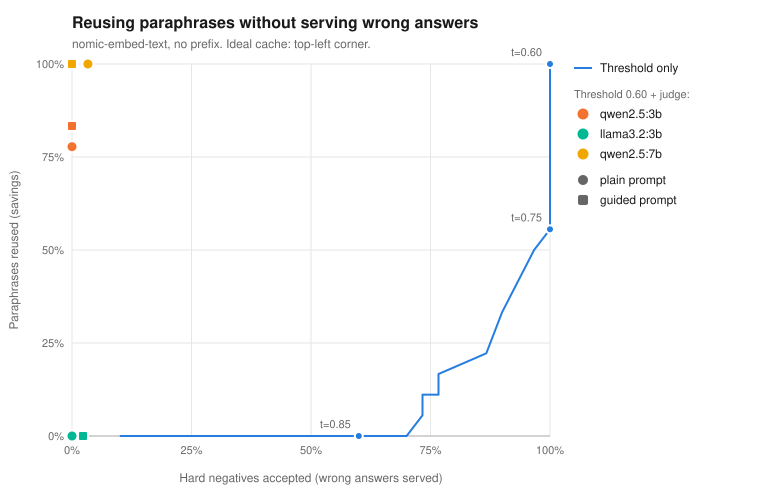

# Semantic cache false hits: when "similar" is not "the same"

**In short:**

- **A similarity threshold alone is not a safety mechanism.** On real patient questions, keeping wrong answers to 1% of related-but-different questions takes a threshold (0.907, with nomic-embed-text) that reuses only 29.5% of true rewrites.
- **A small LLM judge does not escape the trade-off.** On real questions it moves along it, adding seconds per query on CPU; on hand-written pairs it looked far better than it is.
- **Neither does a model trained for the task, as tested.** A cross-encoder trained on duplicate questions reused fewer real rewrites than the cosine threshold at the same share of wrong acceptances.
- **It is not one embedding model.** Three models, one of them multilingual, all rank the hard negatives above the paraphrases.
- **If you run a semantic cache anyway,** pick the threshold from your own traffic's mix of rewrites and near-misses, not from a benchmark, and measure the wrong-answer rate it implies (table in Track A).

A semantic cache reuses the answer to a previous question when a new question is similar enough, measured by the cosine similarity between their embeddings. The upside is real: no model call at all. So is the risk: confidently returning the answer to a **different** question.

This experiment measures that risk. The hypothesis is that questions on the **same topic with a different meaning**, such as "inclusion criteria" and "exclusion criteria", sit as close together in embedding space as true paraphrases do. If that holds, no similarity threshold can safely tell them apart.

## What is measured

The dataset (`data/pairs.jsonl`) has 56 question pairs in the clinical trials domain:

| Category | Pairs | What changes between the two questions | Should the cache reuse the answer? |
|---|---:|---|---|
| `paraphrase` | 18 | Only the wording | Yes |
| `antonym` | 5 | One word swapped for its opposite (inclusion/exclusion, minimum/maximum) | No |
| `negation` | 5 | A "not" (can/can not) | No |
| `entity` | 5 | The subject (FDA/EMA, treatment group/placebo group) | No |
| `number` | 5 | A number (week 4/week 12, 10 mg/50 mg) | No |
| `scope` | 5 | The reach (common/serious side effects, participant/fetus) | No |
| `direction` | 5 | Who acts on whom (sponsor pays participant/participant pays sponsor) | No |
| `unrelated` | 8 | Everything | No |

The six middle categories are the **hard negatives**: the dangerous case.

For every threshold from 0.50 to 0.99, the report shows:

- **Paraphrases reused:** how much the cache saves.
- **Hard negatives accepted:** how often the cache would return a wrong answer.
- **Precision:** of everything the cache returns, how much is correct.
- **Safe threshold:** the lowest threshold at which no hard negative gets through, and how much savings are left there.

## Running it

Requirements: Node.js 22.18 or newer (runs TypeScript directly, no build step) and [Ollama](https://ollama.com).

```bash
ollama pull nomic-embed-text
npm install        # dev dependencies only (typescript, @types/node)
npm run all        # runs with no prefix, then with "search_query: " and "clustering: "
```

For a single configuration:

```bash
npm start -- --model nomic-embed-text --prefix none --reference 0.75
```

| Option | Default | Purpose |
|---|---|---|
| `--model` | `nomic-embed-text` | Any Ollama embedding model |
| `--prefix` | `none` | Task prefix; `nomic-embed-text` was trained with prefixes such as `search_query: ` |
| `--reference` | `0.75` | Threshold highlighted in the report |
| `--host` | `http://localhost:11434` | Ollama address (or the `OLLAMA_HOST` env var) |
| `--data` | `data/pairs.jsonl` | A different pair set |
| `--out` | `results` | Output folder |

Each configuration writes to `results/<model>__<prefix>/`:

- `report.md`: the summary, including the most dangerous hard negatives and the hardest paraphrases;
- `sweep.csv`: the full threshold sweep, ready to chart;
- `pairs.csv`: the similarity of every pair.

Embeddings are cached in `results/.embeddings-cache.json`, so reruns never call the model for texts it has already seen.

Experiment 2 and the chart:

```bash
ollama pull qwen2.5:3b && ollama pull llama3.2:3b && ollama pull qwen2.5:7b
npm run verify     # threshold + LLM judge, writes results/verification/
npm run chart      # writes results/tradeoff.svg
```

`npm run verify` accepts `--judges`, `--prompts` (`plain`, `guided`), `--thresholds` and `--prefix`.

Track A (downloads the dataset at run time):

```bash
npm run track-a    # options: --sample, --judge, --prompt, --judge-thresholds, --time-budget
```

Cross-encoder baseline (no Ollama needed; downloads the model from the Hugging Face Hub and MQP at run time):

```bash
npm run rerank     # options: --model, --revision, --min-similarity, --local-dir; writes results/rerank/
```

More embedding models for Experiment 1:

```bash
ollama pull mxbai-embed-large && ollama pull bge-m3
npm run models
```

Caches and reports identify models by the digest Ollama reports for their tag, not by the tag alone: a tag that is re-pointed to new weights never reuses old embeddings or verdicts, and every report says which weights ran.

Besides the report, Track A writes `results/.annotation/<report-dir>-unlabeled-hits.csv`: every (query, served question) pair the dataset does not label, with an empty `label` column to fill by hand.

Three GitHub Actions workflows run everything and commit the results: `run-experiment.yml` (Experiments 1 and 2, when `data/pairs.jsonl` changes), `track-a.yml` (Track A, on demand) and `rerank.yml` (the cross-encoder baseline, on demand).

```bash
npm test           # metric tests
npm run typecheck  # type checking
```

## Reading the results

- If the similarity range of hard negatives **overlaps** with that of paraphrases, no threshold fixes it: raising the threshold cuts savings before it cuts errors.
- The **safe threshold** is the price of safety: if the cache reuses only 20% of paraphrases there, a plain semantic cache barely pays off in this domain.
- Compare categories. The expectation, to be confirmed by the data, is that negation and number changes are the worst: embedding models tend to capture the topic better than the details that change the answer.

## Limitations

- **Small, hand-written dataset:** 5 pairs per hard-negative category, so each pair is worth 20 percentage points. It shows the phenomenon; it does not estimate a precise rate.
- **Labels are human judgment:** some paraphrase pairs are debatable.
- **One domain, one language:** short English questions about clinical trials. Other domains, languages and models may behave differently.
- **Isolated pairs:** a real cache compares a new question against every stored question, and the nearest neighbor may be a hard negative even when the pair tested here is not.

## Results

All runs below come from the GitHub Actions workflow in this repository (`ubuntu-latest`, CPU only, Ollama). Raw outputs are in [`results/`](results/).

### Experiment 1: threshold only

Hard negatives turned out to be **more** similar than real paraphrases. With no prefix, paraphrases average 0.737 cosine similarity, while every hard-negative category averages between 0.81 and 0.97. Raising the threshold removes paraphrases before it removes wrong answers:

| Embedding model and prefix | Paraphrases reused at 0.75 | Hard negatives accepted at 0.75 | Safe threshold | Paraphrases reused at the safe threshold |
|---|---:|---:|---:|---:|
| `nomic-embed-text`, no prefix | 56% | 100% | 0.994 | 0% |
| `nomic-embed-text`, `search_query: ` | 67% | 100% | 0.996 | 0% |
| `nomic-embed-text`, `clustering: ` | 94% | 100% | 0.998 | 0% |
| `mxbai-embed-large` | 50% | 93% | 0.992 | 0% |
| `bge-m3` (multilingual) | 67% | 90% | 0.992 | 0% |

This is not a property of one model. With `mxbai-embed-large`, paraphrases average 0.744 and the hard-negative categories 0.761 to 0.961; with `bge-m3`, 0.775 against 0.808 to 0.968. In all three models every hard-negative category averages higher than the paraphrases, and the safe threshold reuses nothing.

The worst offenders are role swaps ("Does the sponsor pay the participant?" vs. "Does the participant pay the sponsor?" scores 0.993) and negations. No threshold separates them from paraphrases, so this is not a calibration problem.

### Experiment 2: threshold + LLM judge

The threshold only proposes a candidate; a small local LLM then decides whether one answer fits both questions (`npm run verify`). A hit needs both.



At a permissive threshold of 0.60 (no prefix), out of 18 paraphrases and 30 hard negatives:

| Policy | Paraphrases reused | Hard negatives accepted | Precision | Mean judge latency |
|---|---:|---:|---:|---:|
| threshold only | 100% | 100% | 38% | - |
| + qwen2.5:3b (plain prompt) | 78% | 0% | 100% | 0.9 s |
| + qwen2.5:3b (guided prompt) | 83% | 0% | 100% | 0.9 s |
| + llama3.2:3b (plain prompt) | 0% | 0% | 100% | 0.9 s |
| + qwen2.5:7b (plain prompt) | 100% | 3% (1 of 30) | 95% | 1.9 s |
| + qwen2.5:7b (plain prompt), both orders | 100% | 0% | 100% | 3.7 s (two calls) |
| + qwen2.5:7b (guided prompt) | 100% | 0% | 100% | 1.9 s |

What this shows:

- **A judge fixes what the threshold cannot.** qwen2.5:7b keeps every paraphrase and rejects 29 or 30 of the 30 hard negatives. Its single miss (plain prompt) treats "data collected" and "data shared with the sponsor" as the same question.
- **Safety alone is not enough to judge a judge.** llama3.2:3b answered "different" to every pair: zero wrong answers, zero savings. Any evaluation must report both sides.
- **The guided prompt barely matters.** It names this dataset's categories, so it could have inflated the scores; plain and guided results are nearly identical, which suggests the gain does not come from that leak.
- **The smaller qwen's misses are debatable.** It rejected "Who pays for transportation costs?" vs. "Are travel expenses reimbursed?", which arguably are different questions. The labels are human judgment, not ground truth.
- **Order matters a little.** Every pair was judged as A then B and as B then A. qwen2.5:3b answered differently for 4 of the 56 pairs (3 with the guided prompt), all of them paraphrases. qwen2.5:7b flipped on 1 pair with the plain prompt, and that pair is its one miss: requiring both orders to agree removes it, at twice the judge calls. With the guided prompt it flipped on none.

What it costs and what it does not prove:

- **The judge runs on most traffic.** At 0.60 it is called for 86% of pairs. A judge only saves time when the generation it replaces takes longer than the judge's latency divided by the share of its calls that end in a hit. At 0.60 that break-even is 2.9 to 3.0 s for qwen2.5:3b, 4.7 to 5.0 s for qwen2.5:7b, and 9.9 s for qwen2.5:7b in both orders. GPU latency should be much lower, but it was not measured here.
- **Latency on free runners is not stable.** In this run a call took 0.9 s (3B models) to 1.9 s (7B). In the previous run of the same pairs, on the same kind of runner, it took 1.7 s and 3.9 s. The break-even times above move with it.
- **One verdict changed between runs.** qwen2.5:3b with the plain prompt reused 83% of paraphrases in the previous run and 78% in this one: one more paraphrase rejected, at temperature 0. The earlier run did not record which weights it used, so a re-pointed model tag cannot be told apart from run-to-run variation; reports now state the weights' digests, so the next difference can be.
- **Small samples.** 0 errors in 30 hard negatives still allows a true error rate of up to about 10% (95% confidence, rule of three).
- **The chart nudges overlapping markers sideways** so all of them stay visible; read exact values from the table.

### Track A: real patient questions against a whole cache

Experiments 1 and 2 used pairs I wrote by changing one word. Track A uses real patient questions from [Medical Question Pairs](https://github.com/curai/medical-question-pair-dataset) (McCreery et al., KDD 2020): 1,524 questions, each with a doctor-written **rewrite** that keeps the intent and a **related** question written with similar keywords whose answer would be wrong. The dataset has no license file, so it is downloaded at run time and never committed; the report shows aggregates only.

All 1,524 original questions go into the cache. 150 rewrites and 150 related questions (seed 42) then search the **entire** cache, as they would in production (`npm run track-a`, report in [`results/mqp/report.md`](results/mqp/report.md)).

**Real questions separate better than my hand-written pairs, but not enough.** Rewrites average 0.858 similarity to their original, related questions 0.708, and only 4.7% of related questions are closer than the rewrite. Still, at 0.75 the cache serves a wrong answer to 42% of related questions, and keeping related questions below 1% (pair level) takes a threshold of 0.907, which reuses only 29.5% of rewrites.

**The whole cache adds errors of its own.** Even with no tricky traffic, 3.3% of rewrites matched a *different* cached question at thresholds up to 0.70. MQP only labels each query against its own original, so these hits on a different question are counted as wrong without a label saying so: the wrong-answer rates on this page are an upper bound, and the answers saved a lower bound, until those hits are labeled by hand. Each run lists them in `results/.annotation/` (kept out of git, since it contains dataset text) and counts them in the report's "Hits on a different original" section.

**The judge is much weaker on real questions.** qwen2.5:3b let through 7.3% of related questions (11 of 150), against 0 of 30 in Experiment 2, and rejected a third of valid rewrites (64% reused, against 97% available). Some of those rejections may be right: doctors were told they could change details that would not alter their answer, such as an age.

**Against a higher threshold, the judge is not a clear win.** Wrong answers / answers saved per 1,000 queries that have a close question in the cache, by the share of related questions in that traffic:

| Policy | 0% related | 10% related | 25% related | 50% related |
|---|---:|---:|---:|---:|
| threshold 0.80 | 13 / 773 | 28 / 696 | 50 / 580 | 87 / 387 |
| threshold 0.85 | 0 / 540 | 5 / 486 | 13 / 405 | 27 / 270 |
| threshold 0.60 + qwen2.5:3b judge | 0 / 640 | 7 / 576 | 18 / 480 | 37 / 320 |
| threshold 0.60 + qwen2.5:7b judge | 13 / 860 | 28 / 774 | 50 / 645 | 87 / 430 |

The 3B judge saves more than the 0.85 threshold but also serves more wrong answers, and adds about 2.2 s per query on these runners: it moves along roughly the same trade-off instead of escaping it.

**A bigger judge is more lenient, not more accurate.** qwen2.5:7b reused 86% of rewrites (the 3B judge: 64%) but accepted 16% of related questions (the 3B judge: 7.3%) and served a different cached answer to 1.3% of rewrites. Its wrong-answer counts match the plain 0.80 threshold exactly, with about 11% more answers saved, at 9.2 s per query on CPU (p95 13.9 s). That is a small gain for a large cost, and still worse on errors than the 0.85 threshold. Report: [`results/mqp-qwen2.5-7b/report.md`](results/mqp-qwen2.5-7b/report.md) (top-1 only, since top-3 added nothing for the 3B judge). The 0.85 row is computed from the rates in the report. Passing the top 3 neighbors to the judge instead of the top 1 added nothing (the right question was already the nearest neighbor 96.7% of the time) and slightly more wrong answers.

**So Experiment 2 overstated the judge.** Hand-written, one-word hard negatives are easy for an LLM to spot; real near-misses are not. Two judges and one prompt were tested here, both small enough to run on free CPU runners; a frontier model may do better, at a much higher price per check.

### Cross-encoder baseline

The first objection to an LLM judge is a model trained for the task. `npm run rerank` scores the same pairs with `cross-encoder/quora-distilroberta-base`, trained on duplicate questions, and accepts a pair when its duplicate probability reaches a threshold (report in [`results/rerank/report.md`](results/rerank/report.md)).

**On the hand-written pairs it is worse than every judge that works.** At 0.50 it reuses 17% of paraphrases (3 of 18) and still accepts 10% of hard negatives (3 of 30). Its two highest-scoring wrong pairs are role swaps, at 0.975 and 0.784. Even at 0.05 it reuses 39% of paraphrases while accepting 20% of hard negatives.

**On real questions it does not beat the cosine threshold.** Pair level, all 1,524 MQP items:

| Policy | Related questions accepted | Rewrites reused |
|---|---:|---:|
| cosine threshold 0.85 | 5.7% | 61.0% |
| cross-encoder 0.50 | 5.7% | 49.9% |
| cosine threshold 0.88 | 2.3% | 44.4% |
| cross-encoder 0.95 | 2.2% | 31.6% |

At the same share of wrong acceptances, the cross-encoder reuses fewer rewrites than the embedding threshold it was meant to improve on, and no threshold on its grid keeps related questions at or below 1%. It is cheap, about 46 ms per pair on CPU in batches of 16, against seconds for a judge.

This is one cross-encoder, trained on Quora questions and used on medical ones, at pair level only: it was not run behind the whole-cache simulation of Track A. It says that "use a model trained for equivalence" is not an automatic fix, not that no such model would work.

## Next steps

1. **A judge that reasons before comparing.** A prompt that asks what each question needs to know before deciding, and a cross-encoder trained on in-domain pairs: the general-purpose one tested here did not help.
2. **Production traffic**, the only way to know how often related-but-different questions actually arrive.
3. **Both orders on real questions.** Order symmetry was measured on the hand-written pairs only; Track A still judges one order.
4. **A cost model with prices.** Break-even generation time is reported for CPU latency; GPU latency and prices per call are still open.
5. **More languages.** `bge-m3` is multilingual, but the questions are in English. A commercial embedding model needs an API key and is not included.
6. **Label the unlabeled hits.** Track A's wrong-answer rates stay an upper bound until the hits on a different original are labeled by hand.

## Context

This experiment grew out of studying LLM gateway patterns (semantic caching, model routing, confidence thresholds) in the AI Systems Architecture course of the Applied AI Software Engineering graduate program at UniPDS. The code and dataset in this repository are original.

## License

MIT.
